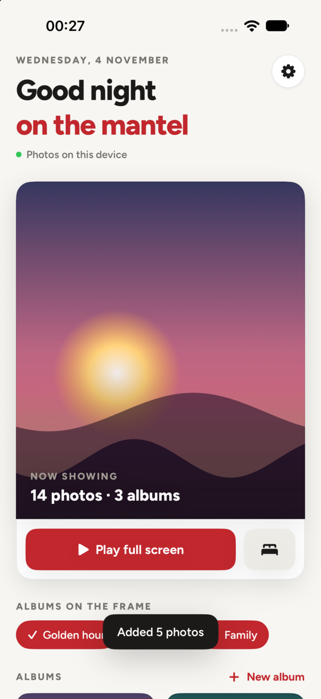
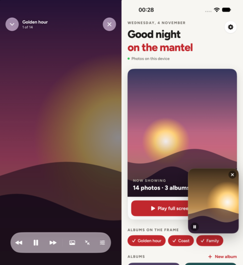
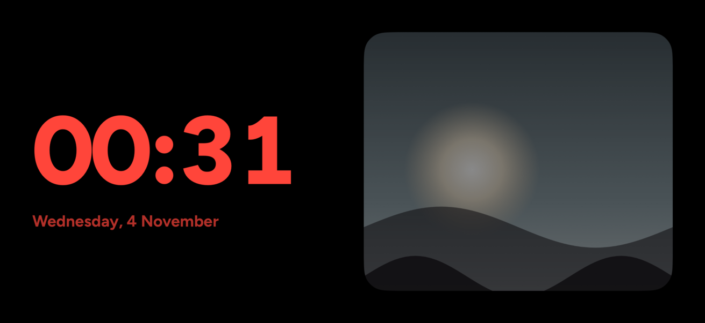

# Mantel for iPhone & iPad

A native SwiftUI Mantel app. It looks like GlamBooth's **Clean** theme: Figtree on off-white, the app red (`#c1272d`), white cards, light and dark mode. iPhone comes first. Landscape and iPad get a two-pane layout.

| Home | Frame + floating mini frame | Nightstand (landscape, at night) |
|---|---|---|
|  |  |  |

## What it does

- **Tab bar:** Home · Albums · Modes · Remote · Settings.
- **12 modes, like the web display:** Slideshow, Grid, Pinterest, Scrapbook, Cover Flow, Clock, Scripture (verse of the day on a matching Unsplash landscape), Mood (Unsplash by mood), Nightstand, FlipBoard (your messages on a split-flap board), Easel (your Easel texts) and Eisenhower (your tasks; tap to tick off). Switch modes from the Modes tab, from the ⊞ button inside the frame, or by swiping sideways in any non-slideshow mode.
- **Remote:** sets the TV/web display's mode, back/next/shuffle, pause, brightness, and which albums it shows. Uses `PATCH /api/display-state`; displays update live over the existing realtime channel. On a mode card, hold and choose **Show on TV**.
- **Photo viewer:** tap a photo to view it full screen. Swipe between photos, pinch or double-tap to zoom, and use the filmstrip along the bottom. **Save** to the iPhone's Photos, **Share**, **Play** from that photo, **Hide**, or **Delete**. You can also hold a photo and choose Save to Photos, or use Select (plus All) to save many at once.

- **Full-screen frame.** Hides the status bar and home indicator and keeps the screen awake. Tap to show the controls, swipe sideways to change photo, and swipe down to shrink the frame into a **floating mini frame** you can drag to any corner. Tap the mini frame to go full screen again.
- **Picture in Picture.** When you leave the app, the slideshow carries on in system PiP above other apps. You can drag it to any corner, and its skip buttons change the photo. There's also a button for it in the frame's top bar. You can turn it off in Settings → Frame → *Keep playing when you leave*.
- **Looks:** *Photo*, *Photo + clock* and *Nightstand*. Nightstand is the StandBy-style view: a big clock beside the photo that turns red and dims from 10 pm to 6 am. The other options are slow drift, fade and slide transitions, fill or whole photo, shuffle, a timer from 6 seconds to 5 minutes, and dimming late at night. In landscape, two portrait photos can sit side by side.
- **Offline first.** The photos in the albums you're showing are saved to the device: 2048 px for the frame and 480 px thumbnails, with a size limit and an option to download on Wi-Fi only. With no internet, the frame plays whatever is saved.
- **Easy to clear.** Settings → Storage shows usage per album, with *Remove* buttons and *Clear all downloads*. Inside an album you can select photos, then **Hide** them (on this device only), remove their downloads, or delete them. Each album's ⋯ menu has *Save all for offline* and *Remove downloads*.
- **Two sources.** Your Mantel account (Drive, Google Photos and upload albums, through the same session cookie the website uses) and **albums kept on this device** that you build from your photo library, with no account needed. You can also upload from the phone into a Mantel upload album.
- **Widgets:** *Photo*, *Photo & Clock*, *Pinterest*, *Mosaic* and *Scripture*, for the Home Screen, StandBy and iPad. Photos change every 1, 5 (the default), 10, 15, 30 or 60 minutes. To show one album on a widget, hold it → **Edit Widget**. Widgets read small copies the app writes to the app group, so they work offline. iOS also wakes the app in the background now and then (`BGAppRefreshTask`, about every 15 minutes or more, at the system's discretion) to pull new photos and refresh the widgets.
- **Networks that block HTTP/3:** URLSession can hang on QUIC when UDP is dropped. Requests that time out are retried over plain TCP + TLS (`TCPFetch`, Network.framework), and the app stays on TCP for the rest of that launch.
- **Control Center / Lock Screen / Action button control: "Play Mantel"**. It opens the frame full screen in one tap. It's also available in Shortcuts and Siri ("Play Mantel").

## Build & install

```bash
brew install xcodegen          # once
cd ios && xcodegen generate    # makes Mantel.xcodeproj (not committed)
scripts/install.sh             # build + install on your plugged-in, unlocked iPhone
```

Xcode must be signed in to your Apple ID first (Xcode → Settings → Accounts). The team in `project.yml` is the free personal team `886M953F89`, so installs **expire after 7 days**. After that, run `scripts/install.sh` again. The first time you install, trust the developer on the phone: Settings → General → VPN & Device Management.

Simulator helpers (launch arguments): `-MantelDemo` paints sample albums, `-MantelPlay` / `-MantelMini` open the frame, `-mode <slideshow|grid|pinterest|scrapbook|coverflow|clock|scripture|mood|nightstand|flipboard|easel|tasks>`, `-MantelLandscape`, `-MantelModes` / `-MantelRemote` / `-MantelSettings` pick a tab, `-MantelAlbum` (`-MantelViewer`) opens the first album (and its viewer), and `-nightDim NO`. Debug builds only: `-MantelLogin <email> <password>` and `-MantelSetTV <mode id>`.

## Layout

```
project.yml            XcodeGen: app + widget extension, app group group.com.nanaamoako.mantel
Shared/                AppGroup paths, widget feed format, PlayFrameIntent, Clean colours + fonts
Mantel/Services        API (mantelapp.vercel.app), ImageCache (disk + memory), Library (albums/offline/widgets), Prefs
Mantel/Player          Player (slideshow), FrameView (full / mini / nightstand), PiP (AVSampleBufferDisplayLayer)
Mantel/Views           Welcome + sign in, Home, Album, Settings + Storage
MantelWidgets/         Photo, Photo & Clock, Mosaic widgets + Play control
Resources/             Figtree static instances (400–800), app icon from brand/mark.svg
```

Endpoints it uses: `GET/PATCH /api/display-state`, `POST /api/display-state/{next,prev,reshuffle}`, `GET /api/modes`, `GET /api/flipboard/messages`, `GET /api/reminders`, `PATCH /api/reminders/:id`, `GET /api/scripture`, `GET /api/unsplash`, `POST /api/auth/login`, `GET /api/auth/me`, `POST /api/auth/logout`, `GET /api/albums`, `GET /api/photos?albumId=`, `DELETE /api/photos/:id`, `POST /api/albums`, `POST /api/photos/upload-url` → `PUT` to the signed storage URL → `POST /api/photos/register`. No server changes are needed.
